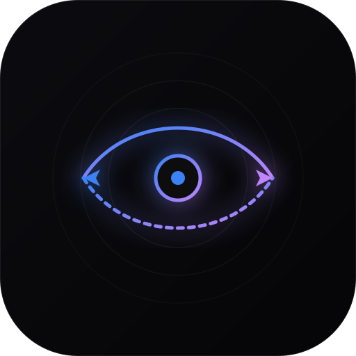

# DRIFT — Lateral Music Discovery & Rating

> **Obsidian Minimalist Editorial** music discovery web application designed to navigate unexpected genres through lateral recommendations.



---

## Overview

DRIFT is built to break users out of conventional algorithmic filter bubbles. Instead of recommending similar tracks from the same genre, DRIFT identifies underlying **sonic characteristics** (texture, tempo, atmospheric space, bass density, production era) and **intentionally pivots laterally** to different styles and traditions.

- **10-Album Crate**: Perfectly sized 5x2 responsive grid fitting your screen with zero vertical scrolling.
- **Lateral Recommendation Engine**: Ratings $\ge 7.0$ preserve the acoustic DNA while bridging into adjacent genres (e.g., *Post-Punk* $\rightarrow$ *Dub Reggae / Krautrock*; *Cool Jazz* $\rightarrow$ *Trip-Hop / Minimal Wave*).
- **Zero API Key Requirement**: Works out-of-the-box using the open MusicBrainz API, Cover Art Archive, and iTunes Search API for 30-second audio previews.
- **Optional Gemini Integration**: Add `VITE_GEMINI_API_KEY` in `.env` to unlock dynamic AI lateral bridging with `@google/genai` (Gemini Flash).
- **Zero-Emoji Policy**: Pure, understated boutique aesthetic using thin-stroke geometric SVG icons (`lucide-react`) and monospace telemetry.

---

## Design System

| Attribute | Specification |
| :--- | :--- |
| **Canvas Background** | `#050507` (Pitch black) |
| **Elevated Panels** | `#0C0C10` with `1px solid rgba(255, 255, 255, 0.06)` border |
| **Card Hover** | `#13131A` |
| **Primary Accent** | `#3B82F6` (Electric Blue) |
| **Secondary Accent**| `#C084FC` (Soft Light Purple) |
| **Typography** | `Plus Jakarta Sans` (UI / headings) & `JetBrains Mono` (telemetry / ratings) |

---

## How to Use DRIFT Daily (Without Hassle or Long Links)

### Option 1: Install as a Desktop / Phone App (PWA)
DRIFT is a Progressive Web App (PWA). You don't need to open terminals or remember long URLs:
1. Open the app in your browser (Chrome, Edge, Safari, Brave).
2. Look at the address bar and click the **Install App** icon (or in Chrome/Edge: **Settings $\rightarrow$ Install DRIFT**).
3. On iOS Safari: Tap **Share $\rightarrow$ Add to Home Screen**.
4. DRIFT will now live directly on your desktop or phone home screen as a standalone, borderless app with its own icon.

### Option 2: 1-Click Free Cloud Deployment (Vercel / GitHub Pages)
To have DRIFT running 24/7 on your own short URL (e.g., `https://drift.vercel.app`):
1. Push this repository to your GitHub account:
   ```bash
   git push -u origin main
   ```
2. Go to [vercel.com](https://vercel.com) and log in with your GitHub account.
3. Click **Add New Project** $\rightarrow$ select your `drift` repository $\rightarrow$ click **Deploy**.
4. Vercel automatically deploys DRIFT in 30 seconds with automatic HTTPS and a clean, permanent link. Every future git push updates it instantly.

---

## Local Development

```bash
# 1. Install dependencies
npm install

# 2. Start dev server
npm run dev

# 3. Build for production
npm run build
```

---

## Project Structure

```
├── .agents/skills/ui-and-recommender/   # Antigravity skill enforcing design invariants
├── public/
│   ├── manifest.json                   # PWA application manifest
│   ├── drift-icon.svg                  # Vector obsidian app icon
│   └── sw.js                           # Offline caching service worker
├── src/
│   ├── components/
│   │   ├── crate/                      # 10-album grid & responsive album cards
│   │   ├── inspector/                  # Tracklist, audio preview, ratings, deep links
│   │   ├── layout/                     # Header, fixed sidebar, taste telemetry
│   │   ├── onboarding/                 # 12-texture calibration modal
│   │   └── views/                      # Rated archive & taste vector visualizations
│   ├── services/
│   │   ├── curatedCatalog.ts           # Curated seed records with audio previews
│   │   ├── musicApi.ts                 # MusicBrainz & iTunes multi-source engine
│   │   └── sonicBridge.ts              # 12 sonic categories & lateral bridge graph
│   ├── types/music.ts                  # Type definitions for crate & ratings
│   └── App.tsx                         # Core application state & layout coordinator
├── DESIGN.md                           # Extracted Stitch design tokens
└── GEMINI.md                           # Master visual & algorithmic invariants
```

---

## License
MIT
